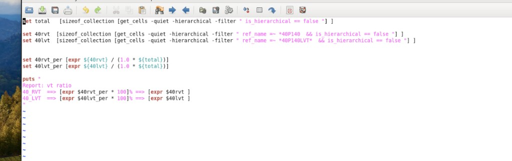

# 统计 VT Cell 比例（RVT / LVT）

> 日期：2026-10-07  
> 来源：截图识别整理（picture-tcl）  
> 阶段：VT / Multi-Vt 检查

统计 design 中各类 **VT cell** 的数量与占比（图中为 40 系列 RVT / LVT）。

## 截图



## 脚本

```tcl
set total [sizeof_collection [get_cells -quiet -hierarchical -filter " is_hierarchical == false " ] ]

set 40rvt [sizeof_collection [get_cells -quiet -hierarchical -filter " ref_name =~ *40P140 && is_hierarchical == false " ] ]
set 40lvt [sizeof_collection [get_cells -quiet -hierarchical -filter " ref_name =~ *40P140LVT* && is_hierarchical == false " ] ]

set 40rvt_per [expr ${40rvt} / (1.0 * ${total})]
set 40lvt_per [expr ${40lvt} / (1.0 * ${total})]

puts "
Report: vt ratio
40_RVT ==> [expr $40rvt_per * 100]% ==> [expr $40rvt ]
40_LVT ==> [expr $40lvt_per * 100]% ==> [expr $40lvt ]
"
```

## 说明

- `is_hierarchical == false`：只统计 leaf cell，不含层次模块。
- `*40P140` / `*40P140LVT*`：按工艺库 ref 命名区分 RVT / LVT；换库时改 filter。
- 用 `1.0 * $total` 做浮点除法，再 `* 100` 打成百分比。

> 注记：`ref_name =~ *40P140` 可能把带 `40P140LVT` 的 LVT 也算进 RVT。若库名确有包含关系，RVT 宜改成更严的 pattern（例如排除 `*LVT*`），或先减 LVT 再算。

## 相关笔记

- [示例：统计 cell 数量](./report-cells.md)
